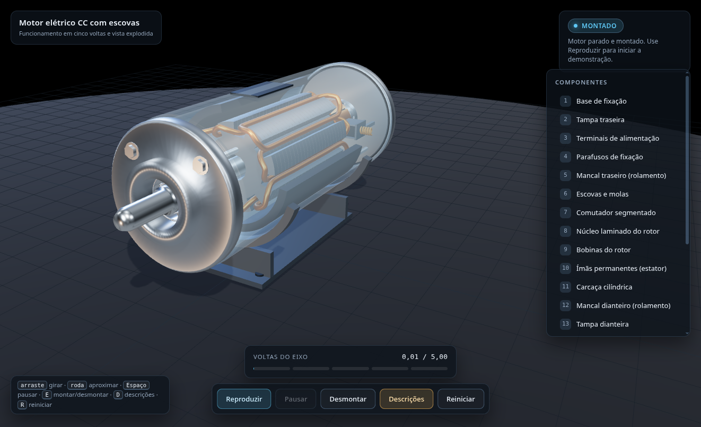
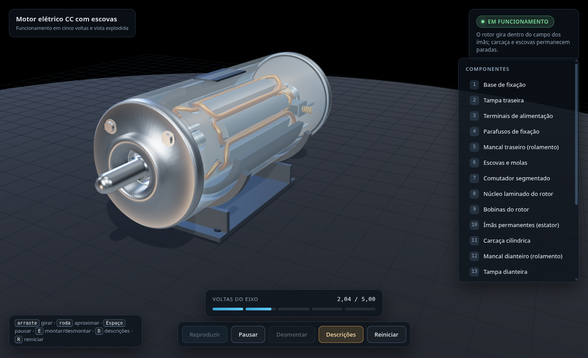
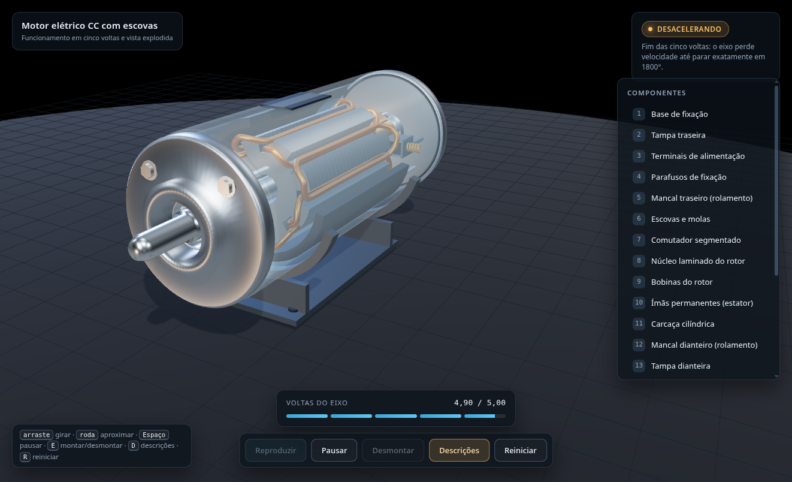
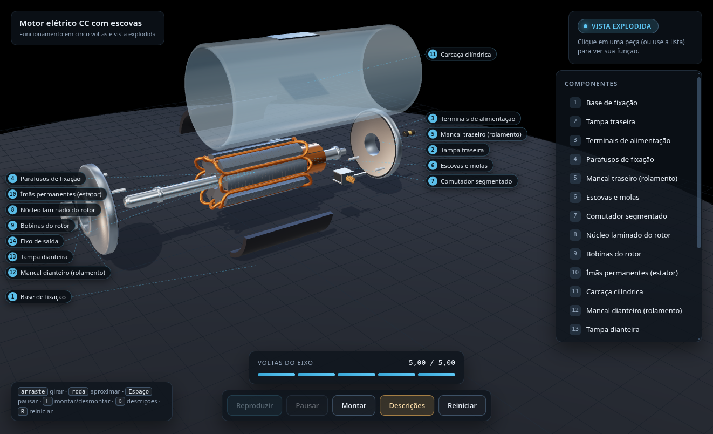
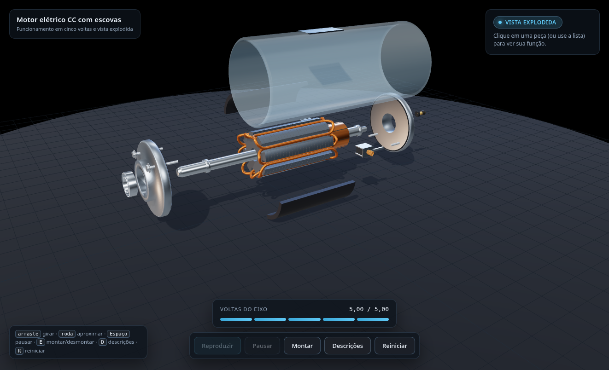

# Motor CC com escovas — simulação 3D

Aplicação Web que apresenta um motor elétrico de corrente contínua com escovas
em três dimensões. O rotor completa **exatamente cinco voltas** (1800°), desacelera
até parar e o motor se abre em uma **vista explodida anotada**.

Tudo é construído proceduralmente com Three.js: **nenhum modelo, textura ou HDR
externo** é necessário.



---

## Sumário

- [Galeria](#galeria)
- [Requisitos](#requisitos)
- [Como rodar](#como-rodar)
- [Controles](#controles)
- [Como a demonstração funciona](#como-a-demonstração-funciona)
- [As cinco voltas, sem erro acumulado](#as-cinco-voltas-sem-erro-acumulado)
- [Carcaça translúcida](#carcaça-translúcida)
- [Vista explodida e rótulos](#vista-explodida-e-rótulos)
- [Arquitetura](#arquitetura)
- [Testes](#testes)
- [Simplificações declaradas](#simplificações-declaradas)
- [Como estender](#como-estender)
- [Depuração](#depuração)
- [Licença](#licença)

---

## Galeria

| | |
|---|---|
|  |  |
| **Montado** — o motor parado, com a carcaça translúcida revelando o rotor. | **Em funcionamento** — o rotor gira; carcaça, ímãs e escovas ficam parados. |
|  |  |
| **Desacelerando** — as cinco voltas terminam com o eixo em repouso. | **Vista explodida** — peças separadas na ordem de montagem, com chamadas numeradas. |
|  | |
| **Vista limpa** — o botão *Descrições* esconde a legenda, a ficha e os rótulos. | |

---

## Requisitos

- **Node.js 20+**
- Navegador moderno com **WebGL 2** (Chrome, Edge, Firefox ou Safari recentes)

## Como rodar

### Scripts prontos

```bash
./start.sh          # instala (se preciso), compila e sobe em http://127.0.0.1:4173
./stop.sh           # encerra o servidor
PORT=8080 ./start.sh
```

O `start.sh` grava o PID em `.server.pid` e a saída em `.server.log`.

### Com npm

```bash
npm install
npm run dev         # desenvolvimento, com HMR
npm run build       # gera dist/
npm run preview     # serve dist/ localmente
```

> ES Modules não funcionam abertos direto do disco (`file://`): sempre use um
> servidor, seja o `vite`/`preview` ou o `start.sh`.

---

## Controles

| Ação | Mouse | Teclado |
|---|---|---|
| Girar a câmera | arrastar | setas |
| Aproximar / afastar | roda | `+` / `-` do `OrbitControls` |
| Pausar / continuar | — | `Espaço` |
| Montar / desmontar | — | `E` |
| Mostrar / ocultar descrições | botão *Descrições* | `D` |
| Reiniciar a demonstração | — | `R` |

A lista **Componentes** é uma alternativa ao clique no modelo: cada item é um
botão que seleciona a peça e abre sua ficha técnica.

---

## Como a demonstração funciona

```
INITIALIZED → ASSEMBLED → RUNNING → DECELERATING → EXPLODING → EXPLODED
                  ↑                                              │
                  └──────────── REASSEMBLING ←───────────────────┘
```

- **RUNNING** — perfil de velocidade trapezoidal: acelera, mantém, desacelera.
- **DECELERATING** — começa quando faltam 1,6 s para o fim; é o próprio trecho
  de desaceleração do perfil, não uma etapa posterior.
- **EXPLODING** — 1,8 s de separação; a câmera enquadra o conjunto expandido e
  os rótulos entram no fim do movimento.
- **REASSEMBLING** — o mesmo caminho ao contrário.

`RESET` é aceito de qualquer estado e devolve tudo ao início, inclusive a câmera.
A **pausa não é um estado**: é uma flag do relógio, o que evita a combinatória
de "RUNNING pausado", "EXPLODING pausado" etc.

---

## As cinco voltas, sem erro acumulado

O ângulo **não** é acumulado quadro a quadro. Ele é uma função fechada do tempo
decorrido:

$$
A(t)=\begin{cases}
\dfrac{v_p\,t^2}{2a} & t<a\\[6pt]
\dfrac{v_p\,a}{2}+v_p\,(t-a) & a\le t\le 1-d\\[6pt]
1-\dfrac{v_p\,(1-t)^2}{2d} & t>1-d
\end{cases}
\qquad
\theta(t)=10\pi\,A(t)
$$

com $v_p = 1/(1-(a+d)/2)$, escolhido para que a área sob o perfil seja exatamente 1.

Isso garante três coisas de uma vez:

1. $\theta(T) = 10\pi$ **por construção** — cinco voltas exatas, sem ultrapassar;
2. independência da taxa de quadros (a função só depende de `t`);
3. nenhum resíduo numérico ao reiniciar.

O `Clock` limita cada `deltaTime` a 0,1 s, de modo que uma aba em segundo plano
não faz o rotor "teleportar" ao voltar.

Detalhes em `src/animation/RotationDriver.js`.

---

## Carcaça translúcida

O casco é um vidro metálico azulado (`opacity 0.34`, `depthWrite: false`) para
que o rotor, as bobinas e os ímãs fiquem visíveis com o motor fechado.

Dois efeitos colaterais foram tratados:

- a casca **não projeta sombra** — uma sombra opaca denunciaria uma parede vazada;
- o seletor de peças a trata como **último recurso**: se houver algo sólido atrás,
  o clique seleciona esse objeto. A carcaça continua selecionável quando nada
  está atrás dela.

---

## Vista explodida e rótulos

As peças se afastam na direção em que seriam realmente removidas:

| Grupo | Direção | Distância |
|---|---|---|
| Carcaça | +X, +Y | 5,2 |
| Tampa dianteira / traseira | ±Z | 2,4 |
| Mancais | ±Z (com as tampas) | +1,0 |
| Parafusos | ±Z | 2,6 |
| Terminais | −Z, +Y | 3,3 |
| Ímãs | radial (±135°) | 1,5 |
| Escovas | ±X | 1,4 |
| Base | −Y | 2,6 |

Eixo, núcleo, bobinas e comutador formam um **subconjunto rígido** e não se
separam — é assim que um motor é de fato desmontado.

Os rótulos são **chamadas técnicas**: saem do centro projetado da peça no sentido
radial, alinham-se em duas colunas (uma borda comum por coluna, sem sobreposição)
e são ligados à peça por linhas-guia em SVG. O layout respeita a área livre da
tela e desvia do bloco de título.

O botão **Descrições** (ou `D`) esconde legenda, ficha e rótulos; a câmera se
reenquadra sozinha para aproveitar a tela que sobrou.

---

## Arquitetura

```
index.html                  canvas + HUD
src/
  main.js                   entrada; detecta WebGL e mostra erro legível
  app/
    App.js                  composição, laço principal, eventos
    Clock.js                deltaTime com pausa e clamp
    StateMachine.js         FSM explícita
    dispose.js              liberação de geometrias/materiais/texturas
  scene/
    createScene.js          renderer, câmera, cenário, resize
    lighting.js             RoomEnvironment + PMREM, luzes, sombras
    CameraRig.js            OrbitControls + tween + enquadramento por peça
  motor/
    dimensions.js           todas as cotas (fonte única)
    materials.js            paleta PBR (uma instância por peça)
    parts.js                catálogo didático
    buildMotor.js           hierarquia + offsets de explosão
    geometries/             um construtor por família de peças
  animation/
    RotationDriver.js       perfil das cinco voltas (puro, testável)
    ExplosionController.js  offsets e progresso da vista explodida
    easing.js
  interaction/
    Picker.js               raycast, hover e realce
    Labels.js               chamadas: colunas + linhas-guia em SVG
  ui/                       estado, progresso, legenda, ficha
tests/                      Vitest
imagens/                    capturas usadas neste README
```

**Hierarquia 3D**

```
motorRoot
├─ staticGroup
│  ├─ base
│  ├─ frontCover → frontBearing
│  ├─ rearCover  → rearBearing
│  ├─ terminals
│  ├─ fasteners (4 parafusos)
│  ├─ brushes   (2 conjuntos: escova + porta-escova + mola)
│  ├─ magnets   (2 polos)
│  └─ housing
└─ rotorGroup          ← único nó que gira (rotação em Z)
   ├─ shaft
   ├─ rotorCore        (24 lâminas instanciadas)
   ├─ windings         (8 bobinas)
   └─ commutator       (8 segmentos)
```

Convenções: eixo do motor em **+Z**, origem no centro da carcaça,
**1 unidade ≈ 1 cm**.

---

## Testes

```bash
npm test
```

| Arquivo | O que verifica |
|---|---|
| `tests/rotation.test.js` | 1800° exatos, monotonicidade, continuidade C¹, independência de FPS, ausência de ultrapassagem |
| `tests/stateMachine.test.js` | tabela de transições, recusa de saltos inválidos, `RESET` de qualquer estado |
| `tests/explosion.test.js` | ida e volta exatas, curva de suavização, saturação em `[0, 1]` |
| `tests/parts.test.js` | catálogo íntegro, hierarquia (o que gira e o que não gira), rigidez do rotor, resíduo numérico zero |

---

## Simplificações declaradas

O modelo é **didático e plausível**, não um CAD validado:

- não há rasgo de chaveta nem furos rosqueados (exigiriam operação booleana);
- o núcleo é um pacote de 24 lâminas, não centenas;
- os rolamentos têm pistas simplificadas e não têm gaiola;
- o comutador é geométrico: não há simulação elétrica nem de desgaste.

As **relações mecânicas**, por outro lado, são respeitadas: eixo, núcleo, bobinas
e comutador giram juntos; escovas e ímãs ficam parados; mancais acompanham as
tampas na desmontagem.

---

## Como estender

- **Mudar proporções**: edite `src/motor/dimensions.js`. Nada mais precisa mudar.
- **Adicionar uma peça**: crie o construtor em `src/motor/geometries/`, registre-o
  em `buildMotor.js` com um `partId` e acrescente a entrada em `parts.js`. Rótulo,
  legenda e ficha aparecem automaticamente.
- **Mudar a duração**: `createRotationProfile({ duration, accel, decel })` em
  `src/app/App.js`. O total de voltas continua exato.

## Depuração

Abra a página com `?debug=1` e use `window.__motorApp` no console:

```js
__motorApp.fsm.state          // estado atual
__motorApp.clock.elapsed      // tempo de animação
__motorApp.advance(10)        // roda a animação quadro a quadro
```

`advance()` é útil quando a aba está em segundo plano e o navegador suspende o
`requestAnimationFrame`.

---

## Licença

Distribuído sob a **Licença MIT**. Veja [LICENSE](LICENSE).

Three.js, Vite e Vitest mantêm suas próprias licenças (MIT).
